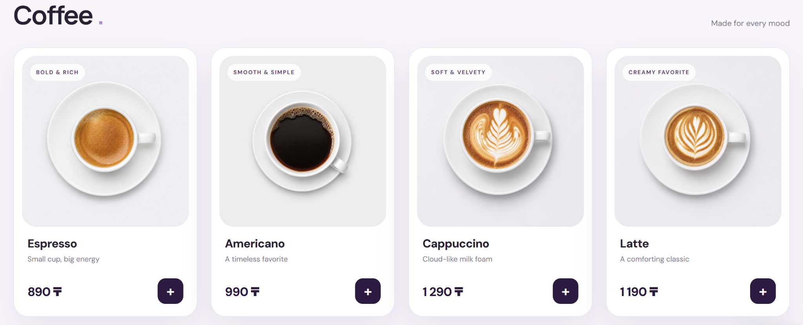
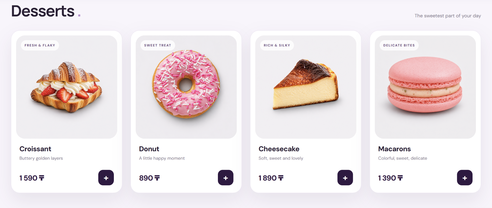
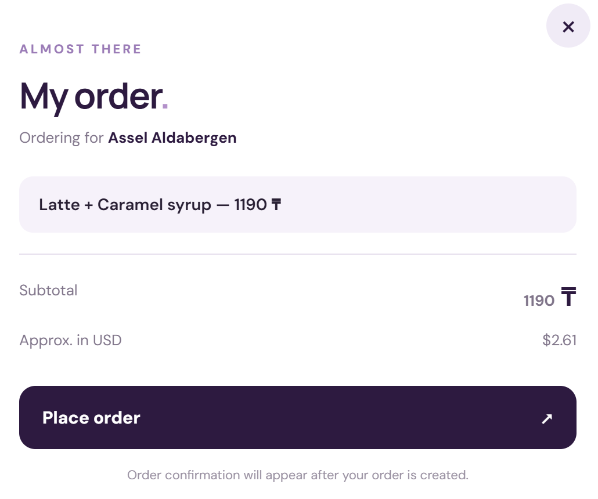

# Coffee Studio

A full-stack coffee ordering website with a lavender-and-deep-purple interface, built as a university project and refined for a design/development portfolio.

## Features

- Responsive coffee and dessert menu with product photography
- Coffee customization with syrup options
- Shopping cart with order totals in KZT and optional USD conversion
- User registration and login with JWT in an HTTP-only cookie
- Order management stored in MongoDB

## Tech stack

**Frontend:** HTML, CSS, JavaScript  
**Backend:** Node.js, Express  
**Database:** MongoDB (Mongoose)  
**Other:** ExchangeRate-API (optional, requires own API key)

## Getting started

1. Install Node.js.
2. Run `npm install` from the project root.
3. Copy `.env.example` to `.env`. Enter your **own** MongoDB URI and a strong JWT secret. For USD conversion, add your ExchangeRate-API key.
4. Ensure your IP is allowed in MongoDB Atlas Network Access.
5. Run `npm start`.
6. Visit `http://localhost:3000`.

**Do not commit `.env` or share credentials.** Never use credentials from another person's environment.

## Project structure

```text
public/          HTML, CSS, JavaScript, menu photographs
controllers/     Authentication, users, orders, currency conversion
models/          MongoDB user and order models
routes/          API endpoints
middleware/      Authentication and error handling
config/          Database connection
app.js           Express app
server.js        Server entry point
```

## API endpoints

- `POST /api/auth/register`, `POST /api/auth/login`, `POST /api/auth/logout`
- `GET /api/users/profile`, `PUT /api/users/profile`
- `POST /api/orders`, `GET /api/orders`, `GET /api/orders/:id`, `PUT /api/orders/:id`, `DELETE /api/orders/:id`
- `GET /api/currency/convert?from=KZT&to=USD&amount=1000`

## Screenshots

A look at the Coffee Studio interface, from browsing drinks and desserts to reviewing an order. Screenshots are from the local project.

### Coffee menu



### Desserts menu



### Shopping cart and currency conversion



*The USD value shown in the screenshot reflects the exchange-rate result at the time of capture; live results may differ.*

## Notes

This is a student/portfolio project, not a production payment service. Payment processing is not integrated, and production systems should validate item prices on the server. Product images may need rights review before commercial reuse.

**Author:** Assel Aldabergen — Astana IT University, Computer Science
